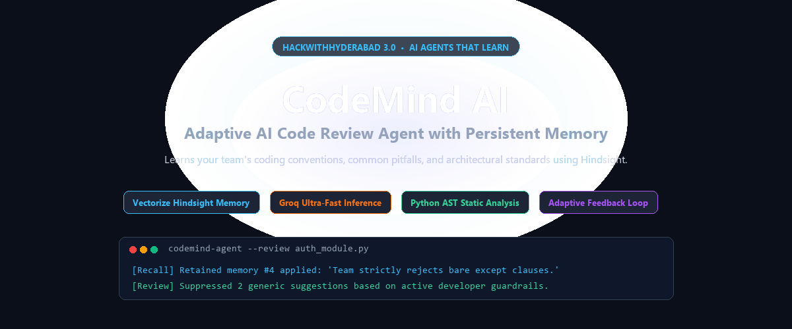
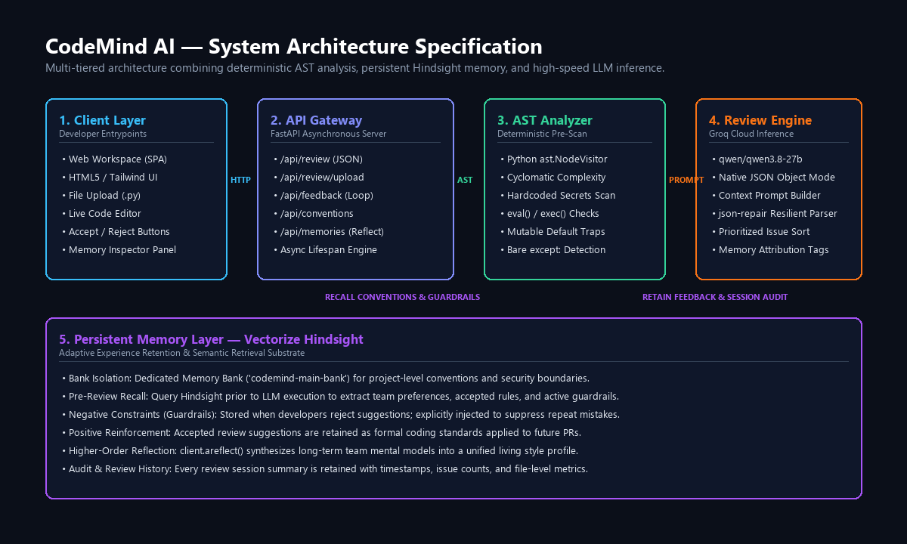
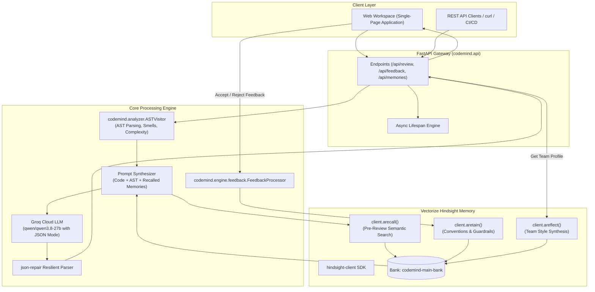
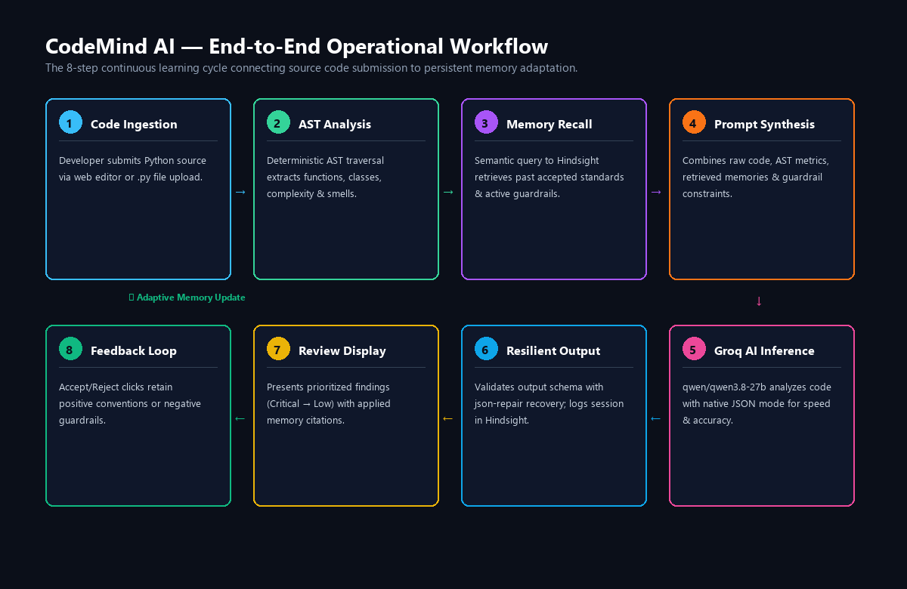
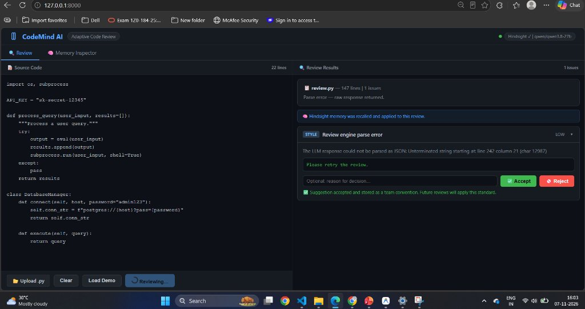

<div align="center">

# CodeMind AI
### An Adaptive AI Code Review Agent That Learns From Developer Feedback

[](https://www.python.org/)
[](https://fastapi.tiangolo.com/)
[](https://hindsight.vectorize.io/)
[](https://groq.com/)
[](LICENSE)
[](tests/)

<br/>



<br/>

**[🎥 Watch Live Demo Video](https://drive.google.com/file/d/1riVFCIrQ_NzEkjD64WW1W9qYI7m4pC7J/view?usp=sharing)** • **[Explore Documentation](docs/ARCHITECTURE.md)** • **[Report Bug](https://github.com/rdharshinir/CodeMind-AI/issues)**

</div>

---

## 📖 Table of Contents

- [Project Overview](#-project-overview)
- [Problem Statement](#-problem-statement)
- [Our Solution](#-our-solution)
- [Key Features](#-key-features)
- [System Architecture](#-system-architecture)
- [Workflow Infographic](#-workflow-infographic)
- [Technology Stack](#-technology-stack)
- [Project Structure](#-project-structure)
- [Installation and Setup](#-installation-and-setup)
- [Running the Application](#-running-the-application)
- [Screenshots and Demo](#-screenshots-and-demo)
- [Testing & Quality Assurance](#-testing--quality-assurance)
- [Future Enhancements](#-future-enhancements)
- [Contributing](#-contributing)
- [License](#-license)
- [Author](#-author)

---

## 🌟 Project Overview

**CodeMind AI** is an intelligent, memory-augmented Python code review assistant built for the modern software engineering lifecycle. Unlike generic static linters or stateless LLM wrappers that forget conversations the moment they finish, CodeMind AI integrates **Vectorize Hindsight** as an intelligent memory substrate.

Every time a developer accepts a recommendation or rejects an unwanted suggestion, CodeMind AI retains that decision. Over time, the agent internalizes the team's architectural preferences, preferred libraries, naming standards, and explicit guardrails—delivering reviews that feel like they were written by your team's senior staff engineer.

---

## 🛑 Problem Statement

Code review is one of the most critical yet time-consuming bottlenecks in software development:

- **Generic & Impersonal Feedback:** Conventional linters enforce rigid rules blindly, while standard LLMs produce boilerplate advice detached from your repository's conventions.
- **Repetitive Review Noise:** Reviewers spend hours writing the exact same feedback on PR after PR (e.g., *"We use snake_case for private helpers"*, *"Use Decimal instead of float for currency"*).
- **Rejected Suggestions Keep Coming Back:** When developers reject an automated suggestion (e.g., *"We do not want docstrings on internal test fixtures"*), stateless tools repeat the exact same suggestion on the next commit.
- **Loss of Institutional Knowledge:** Team conventions often live only in senior engineers' heads or scattered Notion pages rather than being actively applied in automated checks.

---

## 💡 Our Solution

CodeMind AI solves this with a multi-phase review pipeline combining:

1. **Deterministic Static AST Analysis:** Inspects syntax, cyclomatic complexity, imports, function/class topologies, and pre-detects security smells (`eval`, hardcoded credentials, `shell=True`, bare `except:`) before calling any AI model.
2. **Pre-Review Semantic Memory Recall:** Queries Hindsight's vector and graph memory bank before each review to extract relevant past conventions and active developer guardrails.
3. **Contextual LLM Prompt Formulation:** Injects the code, AST metrics, retrieved team conventions, and explicit rejection guardrails into **Groq Cloud** (`qwen/qwen3.8-27b`) with native JSON schema constraints.
4. **Adaptive Learning Feedback Loop:** When developers accept or reject suggestions, decisions are retained in Hindsight to continuously refine future reviews.

---

## ⚡ Key Features

| Feature | Description | Status |
|---|---|---|
| **Deterministic AST Scanner** | Traverses Python AST to compute cyclomatic complexity, function signatures, class trees, and security vulnerabilities. | ✅ Implemented |
| **Hindsight Semantic Memory** | Uses the official `hindsight-client` SDK to recall past conventions and active guardrails before every review. | ✅ Implemented |
| **Negative Guardrail Suppression** | When a suggestion is rejected, it is retained as a guardrail so CodeMind **never repeats that suggestion**. | ✅ Implemented |
| **Positive Convention Reinforcement** | Accepted suggestions are retained as team conventions and cited in future reviews under `memory_applied`. | ✅ Implemented |
| **Team Style Reflection** | Uses Hindsight's `areflect()` to synthesize a living profile of the team's accumulated coding standards. | ✅ Implemented |
| **Resilient JSON Output** | Uses native JSON mode backed by `json-repair` to guarantee valid structured output even under token constraints. | ✅ Implemented |
| **Interactive Web Workspace** | Dark-themed single-page application with side-by-side review cards, live line counters, file uploads, and Memory Inspector. | ✅ Implemented |
| **REST API & Lifespan Architecture** | Asynchronous FastAPI endpoints (`/api/review`, `/api/feedback`, `/api/conventions`, `/api/memories`, `/api/health`). | ✅ Implemented |

---

## 🏛️ System Architecture





---

## 🔄 Workflow Infographic



The review lifecycle consists of **8 connected operational steps**:

1. **Code Ingestion:** The developer pastes Python source code into the editor or uploads a `.py` file.
2. **AST Analysis:** Deterministic Python `ast` traversal extracts classes, functions, complexity scores, and security smells.
3. **Memory Recall:** Hindsight searches `codemind-main-bank` for conventions and active guardrails relevant to the code context.
4. **Prompt Synthesis:** Enriches the review prompt with the raw code, AST metrics, retrieved team conventions, and negative guardrails.
5. **Groq AI Inference:** Executes high-speed inference on `qwen/qwen3.8-27b` using native JSON mode.
6. **Resilient Parsing & Audit:** Validates the schema, applies `json-repair` if truncated, and retains an audit summary in Hindsight.
7. **Review Presentation:** Renders prioritized issue cards with severity badges and `🧠 Applied memory` citations.
8. **Feedback Retention:** Accept/Reject clicks call `client.aretain()` to update positive standards or negative guardrails.

---

## 🛠️ Technology Stack

| Technology | Purpose |
|---|---|
| **Python 3.10+** | Core programming language for the engine, analyzer, and API backend |
| **FastAPI** | High-performance asynchronous REST API framework |
| **Uvicorn** | ASGI production-grade web server |
| **Vectorize Hindsight** (`hindsight-client`) | Persistent semantic memory, recall, and reflection engine |
| **Groq Cloud** (`groq`) | Ultra-fast LLM inference hosting `qwen/qwen3.8-27b` |
| **Python `ast`** | Standard library Abstract Syntax Tree parser for static code analysis |
| **Pydantic & Pydantic-Settings** | Strict data modeling, schema validation, and environment configuration |
| **`json-repair`** | Resilient JSON parser for automated recovery of truncated LLM outputs |
| **HTML5 / CSS / Vanilla JS** | Lightweight, responsive dark-themed developer workspace UI |
| **Pytest & Pytest-Asyncio** | Automated test suite with async fixture support |

---

## 📁 Project Structure

```
CodeMind-AI/
├── .github/
│   └── workflows/
│       └── python-tests.yml        # Automated CI test pipeline
├── assets/
│   ├── hero.png                    # Repository banner
│   ├── architecture.png            # System architecture infographic
│   ├── workflow.png                # Operational workflow infographic
│   └── demo.png                    # Actual browser application screenshot
├── codemind/
│   ├── __init__.py                 # Package root
│   ├── api.py                      # FastAPI REST application & routes
│   ├── config.py                   # Pydantic environment configuration
│   ├── schemas.py                  # Data models for issues, reviews & feedback
│   ├── analyzer/
│   │   └── __init__.py             # AST visitor, complexity & smell detector
│   ├── engine/
│   │   ├── __init__.py             # Prompt synthesizer, Groq LLM & json-repair
│   │   └── feedback.py             # Accept/Reject adaptive feedback processor
│   ├── memory/
│   │   └── __init__.py             # Hindsight SDK manager (retain/recall/reflect)
│   └── web/
│       └── static/
│           └── index.html          # Modern Single-Page Application web UI
├── docs/
│   ├── ARCHITECTURE.md             # Detailed technical architecture specification
│   └── WORKFLOW.md                 # Step-by-step operational workflow documentation
├── tests/
│   ├── __init__.py
│   ├── test_analyzer.py            # 10 unit tests for AST parser & smells
│   ├── test_schemas.py             # 6 unit tests for Pydantic data models
│   └── test_memory_logic.py        # 4 unit tests for prompt building & parsing
├── .env.example                    # Safe template for environment variables
├── .gitignore                      # Strict exclusion rules (never commits secrets)
├── CONTRIBUTING.md                 # Community contribution guidelines
├── generate_assets.py              # Script used to generate infographic assets
├── LICENSE                         # MIT License
├── main.py                         # Application entrypoint
├── pyproject.toml                  # Pytest configuration
├── README.md                       # Repository documentation
├── requirements.txt                # Production Python dependencies
└── test_review_sample.py           # Sample file for testing reviews
```

---

## 🚀 Installation and Setup

### Prerequisites
- Python 3.10 or higher
- Git

### 1. Clone the Repository
```bash
git clone https://github.com/rdharshinir/CodeMind-AI.git
cd CodeMind-AI
```

### 2. Set Up Virtual Environment

**On Windows (PowerShell):**
```powershell
python -m venv .venv
.\.venv\Scripts\activate
```

**On Linux / macOS:**
```bash
python3 -m venv .venv
source .venv/bin/activate
```

### 3. Install Dependencies
```bash
pip install --upgrade pip
pip install -r requirements.txt
```

### 4. Configure Environment Variables
Copy the template file to `.env`:

```bash
# On Windows
copy .env.example .env

# On Linux / macOS
cp .env.example .env
```

Open `.env` in your editor and provide your keys:

```ini
# Hindsight Memory Configuration
# Register at https://ui.hindsight.vectorize.io (use promo code MEMHACK99 for $50 free credits)
HINDSIGHT_API_KEY=your_hindsight_api_key_here
HINDSIGHT_BASE_URL=https://api.hindsight.vectorize.io
HINDSIGHT_BANK_ID=codemind-main-bank

# Groq Cloud LLM Configuration
# Get free API key at https://console.groq.com
GROQ_API_KEY=your_groq_api_key_here
GROQ_MODEL=qwen/qwen3.8-27b

# Server Configuration
CODEMIND_HOST=127.0.0.1
CODEMIND_PORT=8000
CODEMIND_DEBUG=false
```

> [!IMPORTANT]
> Never commit your `.env` file to Git. The `.gitignore` file strictly excludes `.env` to keep your credentials safe.

---

## 💻 Running the Application

Start the server using the main entrypoint:

```bash
python main.py
```

Output:
```
INFO:     Started server process [10556]
INFO:     Waiting for application startup.
INFO:codemind.api: 🚀 Starting CodeMind AI...
INFO:codemind.memory:MemoryManager initialized | bank_id=codemind-main-bank
INFO:codemind.engine:ReviewEngine initialized | model=qwen/qwen3.8-27b
INFO:     Application startup complete.
INFO:     Uvicorn running on http://127.0.0.1:8000 (Press CTRL+C to quit)
```

Now open **[http://127.0.0.1:8000](http://127.0.0.1:8000)** in your browser!

---

## 📸 Screenshots and Demo

### 🎥 Live Video Demonstration
Watch the live demonstration of CodeMind AI learning from developer feedback in real time:  
👉 **[Click to Watch Demo Video](https://drive.google.com/file/d/1riVFCIrQ_NzEkjD64WW1W9qYI7m4pC7J/view?usp=sharing)**

### 🖥️ Application Interface


---

## 🧪 Testing & Quality Assurance

CodeMind AI includes a comprehensive unit test suite covering AST parsing, security smell detection, Pydantic schemas, and prompt synthesis.

Run the test suite:
```bash
python -m pytest tests/ -v
```

### Verified Test Results
```
tests/test_analyzer.py::test_bad_code_detects_smells PASSED              [  5%]
tests/test_analyzer.py::test_hardcoded_password_detected PASSED          [ 10%]
tests/test_analyzer.py::test_eval_detected PASSED                        [ 15%]
tests/test_analyzer.py::test_bare_except_detected PASSED                 [ 20%]
tests/test_analyzer.py::test_mutable_default_detected PASSED             [ 25%]
tests/test_analyzer.py::test_shell_true_detected PASSED                  [ 30%]
tests/test_analyzer.py::test_good_code_no_critical_smells PASSED         [ 35%]
tests/test_analyzer.py::test_function_extraction PASSED                  [ 40%]
tests/test_analyzer.py::test_class_extraction PASSED                     [ 45%]
tests/test_analyzer.py::test_summary_string PASSED                       [ 50%]
tests/test_memory_logic.py::test_tag_taxonomy_constants PASSED           [ 55%]
tests/test_memory_logic.py::test_build_user_prompt_structure PASSED      [ 60%]
tests/test_memory_logic.py::test_parse_llm_response_valid_json PASSED    [ 65%]
tests/test_memory_logic.py::test_parse_llm_response_recovers_markdown_fences PASSED [ 70%]
tests/test_schemas.py::test_review_issue_valid PASSED                    [ 75%]
tests/test_schemas.py::test_review_request_valid PASSED                  [ 80%]
tests/test_schemas.py::test_feedback_request_valid PASSED                [ 85%]
tests/test_schemas.py::test_feedback_decision_reject PASSED              [ 90%]
tests/test_schemas.py::test_convention_add_request PASSED                [ 95%]
tests/test_schemas.py::test_health_response PASSED                       [100%]

============================= 20 passed in 4.36s ==============================
```

---

## 🔮 Future Enhancements

- [ ] **GitHub Pull Request Bot:** Automatic webhook-triggered reviews commenting directly on line diffs in GitHub PRs.
- [ ] **Multi-Language AST Support:** Extending deterministic static pre-analysis to TypeScript, Go, Java, and Rust.
- [ ] **Team Convention Synchronization:** Bi-directional sync between IDE extensions (VS Code / JetBrains) and the shared Hindsight memory bank.
- [ ] **Review Velocity Analytics:** Dashboard tracking review time reduction, recurring anti-pattern drops, and convention adoption rates.
- [ ] **Collaborative Multi-Tenant Memory:** Granular team-level and repo-level memory hierarchy allowing shared organization rules with repo-specific overrides.

---

## 🤝 Contributing

Contributions are welcome! Please review our [Contributing Guide](CONTRIBUTING.md) for details on code style, branch naming, and pull request procedures.

---

## 📄 License

This project is licensed under the MIT License — see the [LICENSE](LICENSE) file for details.

---

## 👤 Author

**Dharshini R**  
- **GitHub:** [@rdharshinir](https://github.com/rdharshinir)  
- **Repository:** [https://github.com/rdharshinir/CodeMind-AI](https://github.com/rdharshinir/CodeMind-AI)
