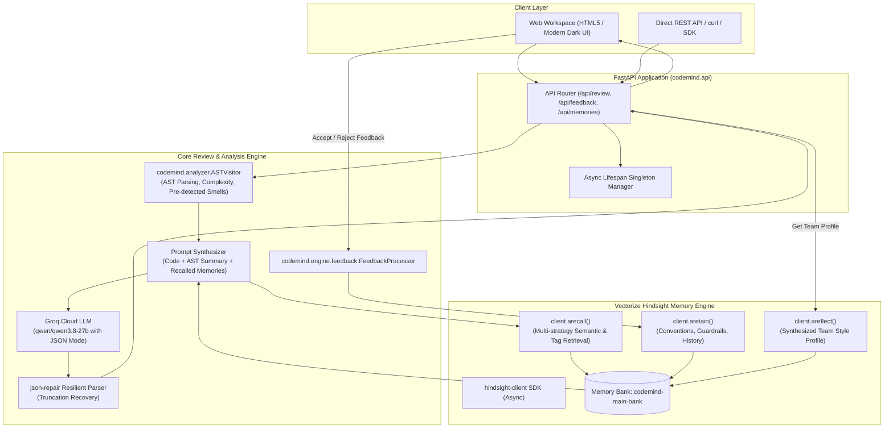

# CodeMind AI — System Architecture Specification

## 1. Executive Architecture Summary

**CodeMind AI** is an adaptive, memory-augmented code review agent designed to solve the critical shortcoming of traditional static linters and stateless LLM reviewers: **lack of institutional memory**.

Traditional tools repeatedly flag the same rejected suggestions (e.g., demanding type annotations on internal test fixtures) or miss team-specific architectural patterns. CodeMind AI bridges this gap by integrating **Python AST static analysis**, **Groq high-throughput LLM inference**, and **Vectorize Hindsight** as an intelligent persistent memory substrate.

---

## 2. Core Architectural Subsystems

### A. Static Pre-Analyzer (`codemind.analyzer`)
Before invoking the LLM, the raw Python code undergoes deterministic AST traversal:
- **`ASTVisitor`**: Inspects function definitions, argument signatures, decorators, docstring presence, class hierarchies, and base classes.
- **Cyclomatic Complexity**: Measures decision branch points (`If`, `While`, `For`, `ExceptHandler`, `BoolOp`, comprehensions) per routine.
- **Early Smell Detection**: Detects security hazards (hardcoded credential patterns, `eval()`, `exec()`, `subprocess.run(..., shell=True)`), runtime traps (mutable default arguments like `[]` or `{}`), and exception antipatterns (bare `except:`).

### B. Memory Subsystem (`codemind.memory`)
Powered by the official `hindsight-client` Python SDK:
- **Tenant Isolation**: Memory is bound to a configurable `HINDSIGHT_BANK_ID` (default: `codemind-main-bank`).
- **Tag Taxonomy**:
  - `accepted_rule`, `convention`: Positive patterns approved by the team.
  - `rejected_rule`, `guardrail`: Negative constraints that instruct future reviews never to repeat rejected suggestions.
  - `custom_rule`: Explicit engineering guidelines added by team leads.
  - `review_history`: Audit records of past review outcomes.
- **Three-Tier Memory Operations**:
  1. `aretain(...)`: Asynchronously stores structured observations and facts.
  2. `arecall(...)`: Multi-strategy semantic retrieval pulling relevant conventions and active guardrails prior to each review.
  3. `areflect(...)`: Synthesizes higher-order mental models of the team's coding preferences.

### C. Prompt Synthesizer & Review Engine (`codemind.engine`)
- Injects AST structural summaries, retrieved Hindsight conventions, and active guardrails into a structured system prompt.
- Invokes Groq LLM using native JSON mode (`response_format={"type": "json_object"}`).
- Cites exact `memory_applied` tags on review issues whenever a stored team convention influences the suggestion.
- **Resilient Fallback**: Uses `json-repair` to automatically recover from any token truncation or malformed syntax.

### D. REST & UI Layer (`codemind.api` & `codemind.web`)
- **FastAPI Backend**: Exposes `/api/review`, `/api/review/upload`, `/api/feedback`, `/api/conventions`, `/api/memories`, `/api/history`, and `/api/health`.
- **Single-Page Application**: Clean, modern dark-themed developer workspace featuring live line counting, code uploading, side-by-side review display, feedback buttons, and a live Memory Inspector.
