# CodeMind AI — Operational Workflow Specification

## End-to-End Application Lifecycle

This document describes the step-by-step data and decision workflow that executes when a developer interacts with **CodeMind AI**.

```mermaid
sequenceDiagram
    autonumber
    actor Dev as Developer
    participant UI as Web Interface / API
    participant Engine as ReviewEngine
    participant AST as AST Analyzer
    participant Hindsight as Hindsight Memory (Vectorize)
    participant LLM as Groq Cloud LLM

    Dev->>UI: Submit Python code (Paste or Upload .py)
    UI->>Engine: POST /api/review (code, filename)
    
    rect rgb(20, 25, 35)
        note over Engine,AST: Step 1: Deterministic Static Analysis
        Engine->>AST: analyze_code(source)
        AST-->>Engine: AnalysisResult (functions, classes, smells, complexity)
    end

    rect rgb(25, 30, 45)
        note over Engine,Hindsight: Step 2: Hindsight Memory Retrieval
        Engine->>Hindsight: arecall(bank_id, query="conventions for code", budget="mid")
        Hindsight-->>Engine: Relevant Accepted Conventions
        Engine->>Hindsight: arecall(bank_id, tags=["guardrail"], budget="low")
        Hindsight-->>Engine: Active Guardrails (Rejected Patterns)
    end

    rect rgb(20, 35, 30)
        note over Engine,LLM: Step 3: Adaptive AI Synthesis
        Engine->>LLM: chat.completions.create(system_prompt + context + code)
        LLM-->>Engine: Structured JSON (Issues + Explanations + Memory Citations)
    end

    Engine->>Hindsight: aretain(review_session_summary)
    Engine-->>UI: ReviewResponse (Issues, Summary, Recalled Memories)
    UI-->>Dev: Display Interactive Issue Cards & Applied Memory Tags

    rect rgb(40, 25, 25)
        note over Dev,Hindsight: Step 4: Developer Feedback Loop
        alt Developer Accepts Suggestion
            Dev->>UI: Click "Accept" (+ optional rationale)
            UI->>Engine: POST /api/feedback (decision="accept")
            Engine->>Hindsight: aretain(content=suggestion, tags=["accepted_rule", "convention"])
            Hindsight-->>UI: Stored as positive team standard
        else Developer Rejects Suggestion
            Dev->>UI: Click "Reject" (+ reason e.g. "We don't type private test fixtures")
            UI->>Engine: POST /api/feedback (decision="reject", reason=...)
            Engine->>Hindsight: aretain(content=rejection_guardrail, tags=["rejected_rule", "guardrail"])
            Hindsight-->>UI: Stored as active guardrail (never repeated)
        end
    end
```

---

## The 8 Operational Workflow Phases

### Phase 1: Code Ingestion
- Developer uploads a `.py` file or pastes Python source directly into the CodeMind web editor.
- The system validates that the input is non-empty and decodable as UTF-8 Python source.

### Phase 2: AST Static Analysis
- Deterministic parsing via Python's standard `ast` library.
- Extracts function signatures, cyclomatic complexity, classes, imports, and docstring coverage.
- Detects baseline code smells: hardcoded secrets, `eval()`/`exec()`, `shell=True`, mutable default arguments (`def f(x=[])`), and bare `except:` clauses.

### Phase 3: Semantic Memory Recall (Pre-Review)
- Queries Hindsight's vector and temporal memory graph using the incoming code context.
- Pulls all previously accepted team conventions matching the file's patterns.
- Pulls all active **guardrails** (past suggestions that developers rejected).

### Phase 4: Contextual Prompt Formulation
- Constructs an enriched prompt combining:
  1. The raw Python code under review.
  2. The AST structural and complexity summary.
  3. The team's stored Hindsight conventions.
  4. The explicit guardrails ("Do NOT suggest these").

### Phase 5: High-Speed LLM Inference
- Sends the synthesized prompt to Groq Cloud (`qwen/qwen3.8-27b`) with native JSON object formatting.
- Enforces strict issue schemas: `id`, `category`, `severity`, `line_start`, `line_end`, `title`, `explanation`, `suggestion`, and `memory_applied`.

### Phase 6: Resilient Output Processing & Session Audit
- Parses and validates JSON output; uses `json-repair` to automatically recover if an output string was truncated.
- Retains the review session summary in Hindsight under the `review_history` tag for auditing.

### Phase 7: Interactive Developer Presentation
- Issues are rendered in priority order (Critical → High → Medium → Low) with category badges (`Security`, `Bug`, `Performance`, `Style`, `Architecture`).
- Issues influenced by past memory prominently display a `🧠 Applied memory: ...` badge.

### Phase 8: Adaptive Learning & Feedback Retention
- Developers can accept or reject any suggestion with a single click, optionally adding a rationale.
- **Accept**: Saved in Hindsight as an accepted team standard, reinforcing this rule in future reviews.
- **Reject**: Saved in Hindsight as a negative constraint (guardrail), guaranteeing that the agent will suppress similar suggestions in subsequent runs.
